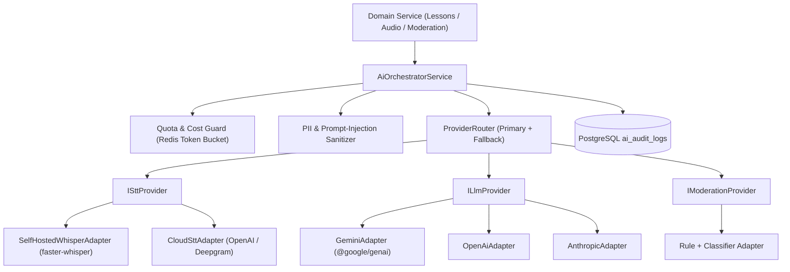

# AI Provider Abstraction & Auditable Processing Architecture

**Scope**: Decoupled AI services for Speech-to-Text (STT), Lesson Segmentation/Translation (YouTube/Media Import), Phonetic/Pronunciation Analysis, Exam Explanation Assistance, and Community Moderation.  
**Related Specs**: [backend-architecture.md](file:///d:/parroto/docs/architecture/backend-architecture.md), [audio-architecture.md](file:///d:/parroto/docs/architecture/audio-architecture.md), [database-schema.md](file:///d:/parroto/docs/database/database-schema.md).

---

## 1. Design Principles

1. **Zero Vendor Lock-In (`IAiProvider` Interfaces)**: Business modules (`lessons`, `vocabulary`, `exams`, `community`) depend exclusively on NestJS DI tokens (`STT_PROVIDER`, `LLM_PROVIDER`, `MODERATION_PROVIDER`), never importing vendor SDKs directly.
2. **Strict Schema Enforcement**: Every LLM JSON output is validated against a versioned **Zod schema** (structured outputs / JSON mode + single repair retry) before persisting or returning to clients.
3. **Full Auditability (`ai_audit_logs`)**: Every AI call records immutable provenance (`traceId`, `userId`, `taskType`, `provider`, `model`, `promptVersion`, `inputSha256`, `tokenInput`, `tokenOutput`, `durationMs`, `estimatedCostUsd`, `status`, `errorCode`) in PostgreSQL without retaining raw PII.
4. **Tiered Execution (Browser-First When Feasible)**: Routine Shadowing ASR runs client-side in Web Worker ONNX (`whisper-tiny.en` / `whisper-base.en`) at zero server compute cost; server AI providers handle async media ingestion, Pro lesson creation, fallback STT on unsupported devices, and moderation.

---

## 2. Provider Abstraction Contracts (`apps/api/src/modules/ai`)

### 2.1 Port Interfaces (TypeScript)
- **`ISttProvider`**:
  - `transcribe(input: { mediaUrl: string; language: string; wordTimestamps: boolean }): Promise<{ text: string; segments: Array<{ startMs: number; endMs: number; text: string; words?: WordTiming[] }>; durationSec: number }>`
- **`ILlmProvider`**:
  - `generateStructured<T>(input: { promptKey: string; promptVersion: string; schema: ZodType<T>; variables: Record<string, unknown>; maxTokens: number; temperature: number }): Promise<{ data: T; usage: { inputTokens: number; outputTokens: number } }>`
- **`IModerationProvider`**:
  - `classifyText(text: string): Promise<{ flagged: boolean; categories: string[]; confidence: number }>`

---

## 3. Core AI Workflows

### Workflow A: Pro YouTube / Audio Lesson Ingestion (`media-ingestion` + `ai-transcription`)
1. Pro user submits YouTube URL or uploads custom audio -> Quota guard validates daily/monthly AI import allowance (`PRO` entitlement required).
2. `media-ingestion` worker validates source metadata/license/duration (`<= 20 min`), normalizes audio into private S3 (`ffmpeg`), and invokes `ISttProvider.transcribe({ wordTimestamps: true })`.
3. `ILlmProvider.generateStructured` (prompt `lesson_enrich_v1`, Zod-validated) produces:
   - Punctuation/sentence boundary cleanup preserving `[startMs, endMs]`.
   - CEFR difficulty classification (`A1–C2`), topic tags, and localized sentence translations.
   - Word-level IPA phonetics lookup (deterministic CMU/IPA dictionary first, LLM fallback strictly for OOV words).
4. Lesson transitions from `PROCESSING` -> `READY` (or `FAILED` with safe diagnostic message + audit log link).

### Workflow B: Client-First + Cloud-Fallback Speech Recognition
- **Default**: Browser Web Worker runs quantized Whisper (`whisper-tiny` / `whisper-base`) + local `PhonemeAligner`. Client posts attempt telemetry (`sentenceId`, `accuracy`, `wordStatuses`) only.
- **Fallback (`cloud-stt`)**: When client WebAssembly/WebGPU initialization fails (`MODEL_UNAVAILABLE`), client uploads short recording (`<= 30s`) via signed PUT URL and calls `POST /api/v1/audio/transcribe-fallback`, which enforces a strict per-user daily fallback limit in Redis and delegates to `ISttProvider`.

### Workflow C: Exam & Grammar Enrichment (Offline / Admin-Triggered Only)
- LLM assistance for generating draft reading explanations or vocabulary example sentences runs exclusively in **admin authoring workflows**, requiring human review (`isPublished = false` until approved) before learner visibility. Active timed IELTS/TOEIC exams are graded 100% deterministically.

---

## 4. Guardrails, Privacy & Cost Governance

- **PII Scrubbing**: User emails, usernames, phone numbers, and free-form chat identifiers are stripped before invoking external LLM/moderation APIs; `ai_audit_logs` stores `SHA-256(prompt + sanitizedInput)` plus truncated redacted previews when debugging is enabled.
- **Per-Tier Budgets (Redis Counters)**:
  - Free users: `0` AI YouTube imports/day, `5` cloud STT fallbacks/day.
  - Pro/Lifetime users: configurable daily AI import & fallback quotas (`429 AI_QUOTA_EXCEEDED`).
- **Circuit Breaker & Timeout**: Every external AI adapter enforces a `30s` HTTP timeout (`60s` for long audio transcription) and trips a Redis circuit breaker after 5 consecutive `5xx` responses, automatically routing to the configured secondary provider.
