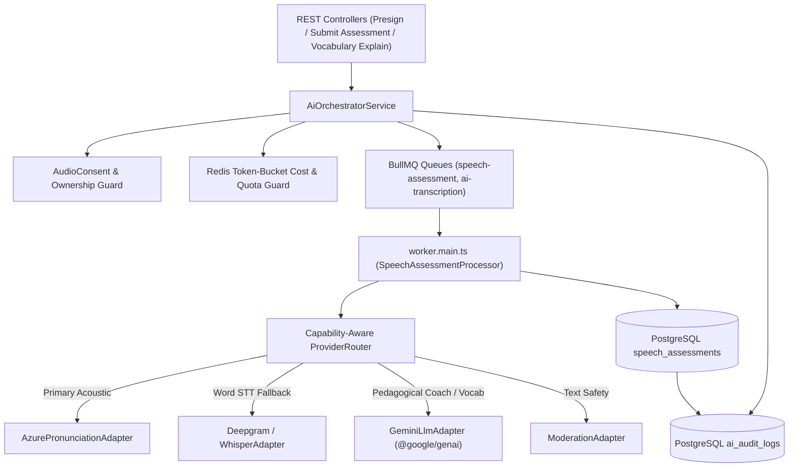

# AI Provider Abstraction & Orchestration Architecture

**Related Specs**: [provider-comparison.md](file:///d:/parroto/docs/ai/provider-comparison.md), [speech-processing.md](file:///d:/parroto/docs/architecture/speech-processing.md), [assessment-schema.md](file:///d:/parroto/docs/ai/assessment-schema.md).

---

## 1. Domain Port Interfaces (Decoupled from Vendors)

All NestJS business logic (`lessons`, `vocabulary`, `exams`, `community`, `speaking`, `ai`) injects pure TypeScript interfaces via NestJS DI tokens:

### Port Contracts
1. **`ISpeechTranscriptionProvider` (`STT_PROVIDER_TOKEN`)**:
   - Returns verbatim transcript, duration, and optional word `[startMs, endMs]` spans (`wordTimestamps`).
2. **`IPronunciationAssessmentProvider` (`PRONUNCIATION_PROVIDER_TOKEN`)**:
   - Declares explicit static capabilities (`supportsPhonemes: boolean`, `supportsProsody: boolean`).
   - Takes a short-lived signed WAV/PCM audio source + optional reference script + exam context (`SHADOWING`, `IELTS_SPEAKING`, `TOEIC_SPEAKING`) and returns genuine acoustic scores **only when `supportsPhonemes`/`supportsProsody` are true**.
3. **`ILlmCoachProvider` (`LLM_PROVIDER_TOKEN`)**:
   - Uses `@google/genai` (or configured fallback) with Zod-derived JSON schema validation (`responseSchema`) for:
     - IELTS Speaking practice rubric coaching (Fluency & Coherence, Lexical Resource, Grammatical Range)
     - TOEIC Listening comprehension hints & Speaking Part 1–5 coaching
     - Vocabulary deep explanations, register notes, collocations, and example sentences
     - Lesson sentence segmentation & CEFR tagging
4. **`IModerationProvider` (`MODERATION_PROVIDER_TOKEN`)**:
   - Classifies UGC text (`comments`, `speaking_rooms`) prior to persistence.

---

## 2. Asynchronous Job Queues, Retries & Timeouts (`BullMQ + Redis`)

Heavy acoustic or LLM workloads execute asynchronously so HTTP requests never hold long sockets:

| Queue | Trigger | Worker SLA & Timeout | Retry & Fallback Strategy |
| :--- | :--- | :--- | :--- |
| `speech-assessment` | `POST /api/v1/ai/speech-assessments` (`202 Accepted`) | `25s` provider HTTP timeout | 2 retries (`2s`, `6s` backoff). If primary phoneme provider trips circuit breaker (`>= 5` consecutive 5xx in 60s), auto-routes to word-level fallback adapter (`phonemes: null`, explicit fallback flag). |
| `ai-transcription` | `media-ingestion` completion | `60s` timeout | 3 exponential retries (`10s`, `30s`, `90s`); fallback from primary cloud STT to secondary STT/local stub. |
| `vocabulary-enrichment` | Admin authoring or batch vocab explanation cache miss | `15s` timeout | 2 retries; caches structured output in Redis (`dict:explain:{word}:{level}`) for `7 days`. |

---

## 3. Security, Usage Metering & Cost Governance

1. **Backend-Only Secrets**: Provider keys (`GEMINI_API_KEY`, `AZURE_SPEECH_KEY`, `DEEPGRAM_API_KEY`) exist exclusively in server `process.env` and are redacted in Pino logs (`logger.service.ts`). Never expose provider URLs or tokens in Next.js `NEXT_PUBLIC_*`.
2. **Per-User Quota & Usage Metering**:
   - Redis sliding daily windows enforce per-tier limits (`FREE`: `5` cloud STT/day, `10` vocab AI lookups/day, `0` phoneme cloud assessments; `PRO`/`LIFETIME`: `120` speech assessments/day, `100` STT fallbacks/day, `200` coaching feedbacks/day).
   - Every AI execution inserts an immutable `AiAuditLog` row (`traceId`, `userId`, `taskType`, `provider`, `model`, `promptVersion`, `inputSha256`, `tokenInput`, `tokenOutput`, `latencyMs`, `estimatedCostUsd`, `status`).
3. **Result Persistence & Pollability**:
   - Async speech assessments persist to `SpeechAssessment` (`status: PENDING -> PROCESSING -> COMPLETED | FAILED`) so clients poll `GET /api/v1/ai/speech-assessments/:id` or receive WebSocket notification on `user:{userId}`.
