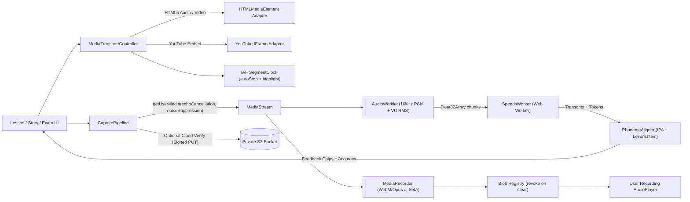

# Audio Processing & Playback Architecture

**Scope**: Browser-native media playback, precision cue synchronization, microphone capture/encoding, local + optional server speech recognition, and secure S3 audio delivery.  
**Input Findings**: Synthesized from [audio-engine-reverse-engineering.md](file:///d:/parroto/research/audio/audio-engine-reverse-engineering.md) and [audio-modules.md](file:///d:/parroto/research/javascript/audio-modules.md).

---

## 1. Design Goals & Key Corrections Over Reverse-Engineered Baseline

| Observed Parroto Behavior | Independent Architectural Decision |
| :--- | :--- |
| Labels generic `MediaRecorder` blobs as `"audio/mp3"` regardless of actual container codec. | Probe `MediaRecorder.isTypeSupported(...)` in priority order (`audio/webm;codecs=opus` -> `audio/mp4;codecs=mp4a.40.2`) and store exact MIME/codec metadata. |
| Uses three separate sync timers (`setTimeout + rAF`, `setInterval(300)`, `YoutubePlayer 100ms` interval). | Consolidate into a single `SegmentClock` using `requestAnimationFrame` + `O(log N)` binary search over sorted `[startMs, endMs]` segments. |
| Runs `@xenova/transformers` inside main bundle flow from Blob URLs. | Run ONNX Runtime Web inside a dedicated **Web Worker**, streaming `16 kHz` mono `Float32Array` PCM via `AudioWorklet` (with cloud STT fallback when device lacks WebGPU/WASM capacity). |
| Uses mutable `<audio>` tag map for UI chimes (`volume = 0.7`). | Pre-decode UI chimes into a shared `AudioContext` `AudioBuffer` pool for deterministic sub-10ms latency across desktop and mobile Safari. |
| Serves public CDN MP3 URLs directly without expiration. | Serve copyrighted/paid lesson & exam audio from **private S3/MinIO storage** via short-lived pre-signed GET URLs (`Range` header supported for `206 Partial Content`). |

---

## 2. Client Audio Engine Component Architecture

---

## 3. Transport, Synchronization & Exam Listening Contracts

1. **Polymorphic `IMediaTransport` Contract**:
   - Exposes `load(source)`, `play()`, `pause()`, `seekMs(ms)`, `setRate(rate: 0.25..2.0)`, `setVolume(0..1)`, `getCurrentMs()`, `getDurationMs()`, and typed `on("play" | "pause" | "ended" | "ratechange" | "error")`.
   - **Range Seeking & Caching**: All self-hosted MP3/M4A files must support HTTP `Accept-Ranges: bytes` (`206 Partial Content`) from S3/CDN so segment jumps (`Replay`, `Next`, Story `-10s/+10s`) never re-download full files.
2. **Exam Listening Mode Rules**:
   - Preload exam listening audio metadata **only after** `POST /exams/sessions/start` succeeds (matching observed zero-preload privacy on public overview pages).
   - **Test Mode**: Lock `setRate(1.0)`, disable manual rewind scrubber if configured by exam rules, and persist highest played checkpoint server-side (`elapsedActiveSeconds`).
   - **Practice Mode**: Unlock speed selector (`0.75x–1.5x`), free seek scrubber, and per-part replay.
3. **Microphone Capture & Permission State Machine**:
   - Explicit states: `IDLE` -> `REQUESTING_MIC` -> `RECORDING` -> `TRANSCRIBING` -> `READY` (plus recoverable `ERROR`: `PERMISSION_DENIED`, `DEVICE_NOT_FOUND`, `MODEL_UNAVAILABLE`, `EMPTY_AUDIO`).
   - Invoking `startRecording()` **deterministically pauses** active lesson/story playback first and cleans up tracks + `URL.revokeObjectURL` on segment switch or unmount.

---

## 4. Server-Side Audio Storage & Processing (`NestJS + ffmpeg + BullMQ`)

1. **Pre-Signed Direct Upload / Download Flow**:
   - Clients never upload large audio buffers through NestJS memory.
   - To persist optional voice recordings or admin/creator audio lessons:
     1. Client requests `POST /api/v1/media/presign-upload` (`purpose`, `mimeType`, `contentLength`, validated against `<= 25 MB` & allowlisted audio MIMEs).
     2. NestJS issues a `5-min` S3 pre-signed `PUT` URL bound to `Content-Type` and `Content-Length` headers and creates a `media_assets` row (`status = PENDING_UPLOAD`).
     3. Client uploads directly to S3, then calls `POST /api/v1/media/{id}/confirm` which verifies object existence/magic bytes via S3 `HeadObject` and enqueues `media-ingestion`.
2. **Transcoding & Loudness Normalization (`worker.main.ts`)**:
   - `ffmpeg` normalizes incoming lesson/exam audio to **LUFS `-16`** (`loudnorm`), encodes adaptive AAC/MP3 (`128 kbps`, `44.1 kHz`, fast-start moov atom), extracts exact `durationMs`, and deletes raw unvalidated staging objects.
3. **Retention & Privacy Policy for Learner Recordings**:
   - By default, **Shadowing practice works 100% locally in browser** (`URL.createObjectURL` + ONNX Worker; zero audio leaves the device).
   - If a user explicitly enables `"Cloud Pronunciation Review"` or `"Voice Room Recording Moderation"`, uploaded user recordings carry a strict S3 lifecycle expiry (`30 days` or immediate deletion upon user request).
4. **Live 1-on-1 Speaking Rooms (`/speaking`)**:
   - Out-of-scope of HTTP file upload: uses WebSocket signaling (`NestJS CommunityGateway`) to broker WebRTC `RTCPeerConnection` ICE/SDP offers (with `coturn` TURN relay for symmetric NATs) or an abstracted SFU adapter (`LiveKit`).
