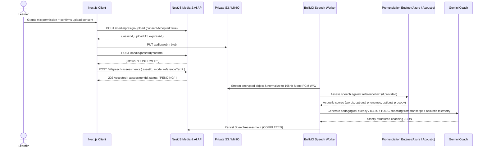

# Speech Processing, Consent & Media Privacy Architecture

**Scope**: Learner consent enforcement, secure pre-signed audio capture, server-side acoustic normalization, pronunciation vs fluency pipelines, and recording deletion lifecycle.

---

## 1. Privacy & Consent Workflow

LinguaCraft treats voice recordings as sensitive biometric-adjacent personal data:

1. **Explicit Consent Gate Before Capture**:
   - Frontend microphone UI displays a clear notice explaining whether audio stays local in-browser or will be uploaded for cloud pronunciation/IELTS analysis.
   - Cloud upload (`POST /api/v1/media/presign-upload`) and speech assessment (`POST /api/v1/ai/speech-assessments`) **require explicit consent acknowledgment** (`consentAccepted: true` recorded with timestamp & policy version in user/asset metadata -> rejects with `403 AUDIO_CONSENT_REQUIRED` if missing).
2. **Private Object Storage**:
   - Recordings are uploaded directly from the browser to a **private** S3/MinIO bucket via short-lived (`5–10 min`) single-key `PUT` URLs bounded to `uploads/recordings/{userId}/{assetId}.{ext}` (`<= 25 MB`, allowlisted audio MIMEs).
   - Server confirms object existence via S3 `HeadObject` before queuing any processing.
   - Zero public ACLs or permanent CDN URLs are ever created for learner recordings.
3. **Right to Deletion (`DELETE /api/v1/media/:assetId`)**:
   - Users can delete any uploaded recording at any time (`DELETE /api/v1/media/:assetId`).
   - Backend validates strict ownership (`asset.ownerId === principal.userId`), issues S3 `DeleteObjectCommand`, deletes or tombstones associated `MediaAsset` and clears raw audio references on `SpeechAssessment` (`audioDeletedAt = now()`).
   - Unreferenced temporary recordings expire automatically via lifecycle TTL (`expiresAt` <= 30 days by default).

---

## 2. Acoustic Normalization & Alignment Pipeline

---

## 3. Domain Feature Specialization

1. **Audio Alignment with Reference Transcript**:
   - Scripted modes (`SHADOWING`, `TOEIC_SPEAKING_READ_ALOUD`): Reference text is supplied to forced alignment (`IPronunciationAssessmentProvider`), producing exact `[startMs, endMs]` per word and detecting **omissions**, **insertions**, and **mispronunciations**.
   - Free-speech modes (`IELTS_SPEAKING`, `TOEIC_SPEAKING_OPINION`): Unscripted assessment runs ASR transcription first, then aligns spoken words to audio frames without expecting a fixed script.
2. **Phoneme-Level vs Word-Level Honest Boundaries**:
   - Phoneme arrays (`ipa`, `accuracyScore`, `errorType`) are emitted **only** when `providerCapabilities.supportsPhonemes === true` (e.g., Azure Speech Pronunciation Assessment).
   - Stress and intonation (`prosody.stressScore`, `prosody.intonationScore`, `prosody.rhythmScore`) are emitted **only** when `providerCapabilities.supportsProsody === true`.
3. **IELTS Speaking & TOEIC Listening/Speaking Support**:
   - **IELTS Speaking (`Part 1`, `Part 2`, `Part 3`)**: Measures objective acoustic Speech Rate (`WPM`), pause ratio, and filler frequency, then feeds transcript + acoustic pace into `ILlmCoachProvider` for rubric feedback on *Fluency & Coherence*, *Lexical Resource*, *Grammatical Range & Accuracy*, plus *Pronunciation* practice guidance clearly marked as **AI Coaching Estimate (Not Official Band Certification)**.
   - **TOEIC Listening & Speaking**: Generates contextual comprehension breakdown explanations (why distractors fail in Part 2/3/4 dialogues) alongside Part 1–5 Speaking task timing, completeness, and delivery feedback.
