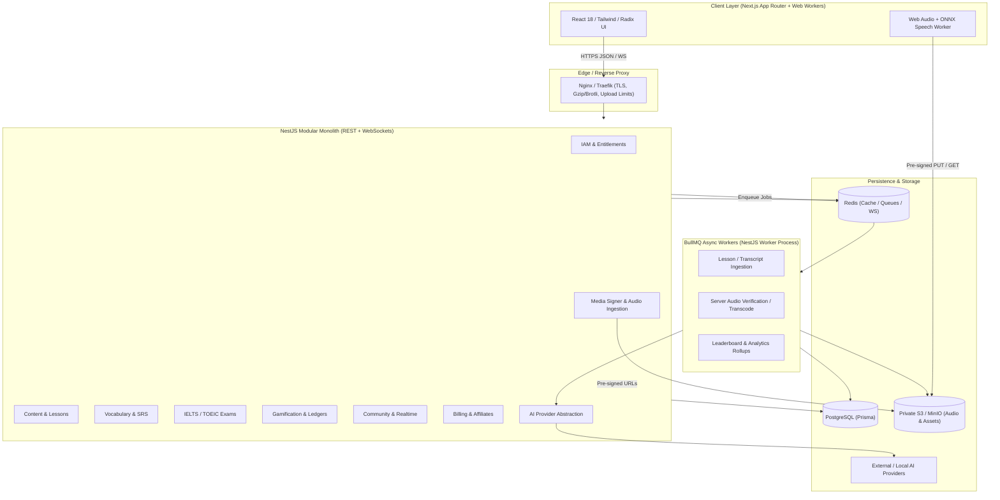

# System Architecture — Independent English Learning Platform

**Status**: Proposed Architecture (Review Required Before Implementation)  
**Target Stack**: Next.js (App Router), React, TypeScript, Tailwind CSS · NestJS, PostgreSQL, Prisma, Redis · Docker & S3-Compatible Storage  
**Input Basis**: All reverse-engineering findings under `research/website/`, `research/javascript/`, `research/api/`, `research/modules/ielts-toeic-exams/`, and `research/audio/`. *(Note: `docs/` and `evidence/` did not contain prior files.)*

---

## 1. Reverse-Engineering Evaluation: Confirmed Findings vs. Unresolved Gaps

### 1.1 Confirmed Platform Capabilities (Evidence-Backed)
1. **Multi-Shell Learning Experience** ([website-overview.md](file:///d:/parroto/research/website/website-overview.md), [navigation-map.md](file:///d:/parroto/research/website/navigation-map.md)):
   - Two primary shells (Marketing top-bar shell for editorial/pricing/login; App sidebar shell with collapsed mobile drawer, global dictionary search modal, 17-language UI switcher, and translation language selector) plus distraction-free vertical media feed (`/shorts`).
2. **Core Learning Modules** ([page-inventory.md](file:///d:/parroto/research/website/page-inventory.md), [api-feature-matrix.md](file:///d:/parroto/research/api/api-feature-matrix.md)):
   - **Dictation & Shadowing**: YouTube/MP3/MP4 lessons across CEFR `A1–C2` & topic tags; `Easy`/`Normal`/`Hard` dictation masking; Watch vs. Learn modes in shadowing; on-device Whisper ONNX ASR + IPA articulatory feedback; `Free` vs. `PRO` gating.
   - **Vocabulary & Dictionary**: System + public user decks (`301` ID-to-slug canonical redirects), 24-word guest previews, bilingual dictionary search (`/api/dictionary/search`) & word audio/definitions, personal notebooks, and `/review` SRS queue.
   - **Grammar & Stories**: A1–C2 grammar curriculum with interactive audio examples and status filters; graded stories (`Listen & read` synced audio + `Read only`, word highlights, bookmark saves).
   - **IELTS & TOEIC Mock Exams** ([user-flow.md](file:///d:/parroto/research/modules/ielts-toeic-exams/user-flow.md)): Exam sets -> individual test overview -> `Test Mode` vs. `Practice Mode` + TOEIC 7-part filtering + live question/minute estimation + paginated score comments.
   - **Community, Gamification & Monetization**: Monthly leaderboards with tier rewards, streaks & freeze items, diamond wallet & cosmetic shop, daily missions, community forum/chat/feedbacks, and card/domestic-bank/lifetime billing + referrals.
3. **Observed Client-Side Security & Transport Patterns** ([api-data-contracts.md](file:///d:/parroto/research/api/api-data-contracts.md)):
   - Parroto uses client-side AES-GCM response envelopes (`{"encrypted": true, "data": "..."}`), obfuscated `o.$` request wrapping, and `generateKey` guest tokens to deter casual scraping over HTTP. **Architectural decision**: Our independent platform replaces client obfuscation (which exposes keys in browser bundles) with standard TLS, HTTP-only refresh cookies, short-lived JWTs, server-side authorization checks, strict rate limiting, and short-lived pre-signed media URLs.

### 1.2 Unresolved Questions & Inaccessible Subsystems (Designed Independently)
1. **Authenticated Exam Runner & Scoring Curves** (`/exams/{ielts,toeic}/session/*`): Resolved via an explicit question-group data model, server-enforced Test Mode deadlines, and published IELTS/TOEIC band/scaled conversion tables.
2. **Authoritative Server Grading** (`POST /sentences/submit*`): Resolved by retaining auditable client/server attempt records without trusting unverified client scores for currency/XP rewards beyond configurable thresholds.
3. **YouTube AI Lesson Ingestion** (`CREATE LESSON` from YouTube URL): Designed cleanly as an asynchronous BullMQ pipeline + pluggable AI provider (`SttProvider` + `LlmProvider` forced alignment & translations).
4. **Live Voice Chat & Vocab Battle PvP** (`/practice-english-speaking`, `/vocab-battle`): Real-time transport chunks were post-login; designed cleanly via NestJS WebSocket Gateway (Redis Pub/Sub adapter) + optional pluggable WebRTC SFU (e.g., LiveKit) for multi-party voice rooms.
5. **Account Compliance**: Privacy policy references DOB age verification for private chat; modeled explicitly via an `ageVerifiedAt` / `birthDate` compliance gate inside `iam`.

---

## 2. Bounded Contexts & Domain Architecture

The platform adopts a **Modular Monolith (NestJS)** separated into **9 strict Bounded Contexts**, backed by **PostgreSQL** (relational truth + ledgers), **Redis** (sessions, BullMQ queues, rate limits, leaderboards, WS Pub/Sub), and **S3-Compatible Object Storage** (private media buckets).

---

## 3. Core Non-Functional Architecture Principles

1. **Zero Proprietary Dependence**: Zero calls to `api.parroto.app`, Parroto R2 buckets, Firebase auth keys, or minified encryption routines.
2. **End-to-End Type Safety**: Shared TypeScript contracts (Zod schemas + OpenAPI types) between Next.js and NestJS inside a pnpm/Turborepo workspace (`packages/contracts`).
3. **Secure Media Storage**: All lesson MP3/MP4, user recording uploads, and exam listening tracks reside in **private S3 buckets** served through short-lived (`5–15 min`) HMAC pre-signed URLs or Cloudflare/CDN signed cookies; zero public bucket listing.
4. **Ledger Integrity & Anti-Tamper**: Diamonds, XP, streak freezes, and Pro entitlements use append-only **ledger transactions** (`idempotencyKey` enforced) rather than mutable integer increments from untrusted client payloads.
5. **Auditable AI Processing**: Every AI invocation (`transcription`, `lesson_generation`, `pronunciation_feedback`, `content_moderation`) writes a structured `ai_audit_logs` entry containing provider, model, prompt version, input hash, latency, token/cost accounting, and failure diagnostics.
6. **Horizontal Split Readiness**: API HTTP pods, WebSocket pods, and BullMQ AI/audio workers scale independently behind Redis and PostgreSQL without refactoring domain modules.
