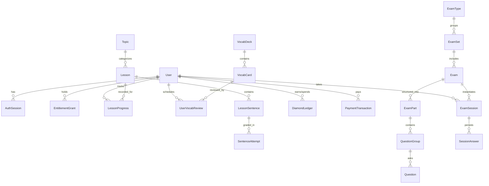

# PostgreSQL Database Schema (Prisma Data Model)

**Database**: PostgreSQL 16+ · **ORM**: Prisma  
**Design Rules**: UUID primary keys (`@default(uuid())`), explicit relational foreign keys across bounded contexts, immutable financial/XP ledgers, composite indexes matching hot query patterns, and zero dependency on Firebase or Parroto proprietary identifiers.

---

## 1. Entity-Relationship Overview



---

## 2. Canonical Prisma Schema Specification (`apps/api/prisma/schema.prisma`)

```prisma
generator client {
  provider = "prisma-client-js"
}

datasource db {
  provider = "postgresql"
  url      = env("DATABASE_URL")
}

// ---------------------------------------------------------
// 1. IAM & ENTITLEMENTS
// ---------------------------------------------------------
enum UserRole {
  USER
  MODERATOR
  ADMIN
}

enum AccountStatus {
  ACTIVE
  BANNED
  SUSPENDED
}

enum EntitlementTier {
  FREE
  PRO
  LIFETIME
}

model User {
  id                     String        @id @default(uuid())
  email                  String        @unique
  passwordHash           String?
  username               String?       @unique
  displayName            String
  avatarUrl              String?
  role                   UserRole      @default(USER)
  status                 AccountStatus @default(ACTIVE)
  birthDate              DateTime?     @db.Date
  ageVerifiedAt          DateTime?
  audioConsentAt         DateTime?
  audioConsentVersion    String?
  preferredUiLocale      String        @default("en")
  preferredTranslateLang String        @default("vi")
  selectedAvatarFrameId  String?
  selectedBackgroundId   String?
  selectedBadgeId        String?
  createdAt              DateTime      @default(now())
  updatedAt              DateTime      @updatedAt

  oauthAccounts     OAuthAccount[]
  sessions          AuthSession[]
  entitlements      EntitlementGrant[]
  stats             UserStats?
  lessonProgress    LessonProgress[]
  sentenceAttempts  SentenceAttempt[]
  vocabDecks        VocabDeck[]
  vocabReviews      UserVocabReview[]
  examSessions      ExamSession[]
  comments          Comment[]
  communityPosts    CommunityPost[]
  speakingRooms     SpeakingRoom[]
  diamondEntries    DiamondLedger[]
  xpEntries         XpLedger[]
  inventory         UserInventory[]
  transactions      PaymentTransaction[]
  affiliateAccount  AffiliateAccount?
  notifications     Notification[]

  @@index([status])
}

model OAuthAccount {
  id             String   @id @default(uuid())
  userId         String
  provider       String   // "google" | "apple"
  providerUserId String
  createdAt      DateTime @default(now())
  user           User     @relation(fields: [userId], references: [id], onDelete: Cascade)

  @@unique([provider, providerUserId])
  @@index([userId])
}

model AuthSession {
  id               String    @id @default(uuid())
  userId           String
  familyId         String
  refreshTokenHash String    @unique
  userAgent        String?
  ipHash           String?
  expiresAt        DateTime
  revokedAt        DateTime?
  createdAt        DateTime  @default(now())
  user             User      @relation(fields: [userId], references: [id], onDelete: Cascade)

  @@index([userId, revokedAt])
  @@index([familyId])
}

model EntitlementGrant {
  id            String          @id @default(uuid())
  userId        String
  tier          EntitlementTier
  source        String          // "stripe" | "paddle" | "vietqr" | "promo" | "admin"
  transactionId String?
  startsAt      DateTime        @default(now())
  expiresAt     DateTime?       // null when tier == LIFETIME
  revokedAt     DateTime?
  createdAt     DateTime        @default(now())
  user          User            @relation(fields: [userId], references: [id], onDelete: Cascade)

  @@index([userId, expiresAt, revokedAt])
}

// ---------------------------------------------------------
// 2. MEDIA ASSETS & AI AUDIT LOGS
// ---------------------------------------------------------
enum MediaAssetStatus {
  PENDING_UPLOAD
  PROCESSING
  READY
  FAILED
}

model MediaAsset {
  id           String           @id @default(uuid())
  ownerId      String?
  purpose      String           // "lesson_audio" | "story_audio" | "exam_audio" | "user_recording" | "image"
  bucket       String
  objectKey    String           @unique
  mimeType     String
  sizeBytes    Int
  durationMs   Int?
  sha256       String?
  status       MediaAssetStatus @default(PENDING_UPLOAD)
  expiresAt    DateTime?
  createdAt    DateTime         @default(now())
  updatedAt    DateTime         @updatedAt

  @@index([ownerId, purpose])
  @@index([expiresAt])
}

model AiAuditLog {
  id               String   @id @default(uuid())
  traceId          String
  userId           String?
  taskType         String   // "stt_transcribe" | "lesson_enrich" | "moderation"
  provider         String   // "whisper_local" | "openai" | "gemini"
  model            String
  promptVersion    String?
  inputSha256      String
  tokenInput       Int      @default(0)
  tokenOutput      Int      @default(0)
  latencyMs        Int
  estimatedCostUsd Decimal  @default(0) @db.Decimal(10, 6)
  status           String   // "SUCCESS" | "FAILED"
  errorCode        String?
  createdAt        DateTime @default(now())

  @@index([userId, createdAt])
  @@index([taskType, status, createdAt])
}

model SpeechAssessment {
  id               String    @id @default(uuid())
  userId           String
  mediaAssetId     String?
  mode             String
  status           String    @default("PENDING")
  measurementTier  String?
  acousticProvider String?
  coachProvider    String?
  referenceText    String?
  transcript       String?
  resultJson       Json?
  errorCode        String?
  audioDeletedAt   DateTime?
  createdAt        DateTime  @default(now())
  completedAt      DateTime?
  user             User      @relation(fields: [userId], references: [id], onDelete: Cascade)

  @@index([userId, createdAt])
  @@index([mediaAssetId])
}

// ---------------------------------------------------------
// 3. LESSONS, GRAMMAR & STORIES
// ---------------------------------------------------------
enum CefrLevel {
  A1
  A2
  B1
  B2
  C1
  C2
}

enum MediaTransportType {
  YOUTUBE
  AUDIO
  VIDEO
}

enum LessonVisibility {
  SYSTEM
  COMMUNITY_PUBLIC
  PRIVATE
}

model Topic {
  id        String   @id @default(uuid())
  slug      String   @unique
  nameJson  Json     // { "en": "...", "vi": "..." }
  sortOrder Int      @default(0)
  lessons   LessonTopic[]
}

model Lesson {
  id              String             @id @default(uuid())
  slug            String             @unique
  title           String
  description     String?
  mediaType       MediaTransportType
  youtubeVideoId  String?
  mediaAssetId    String?
  thumbnailUrl    String?
  cefrLevel       CefrLevel
  durationSec     Int
  isPro           Boolean            @default(false)
  isDailyFeatured Boolean            @default(false)
  visibility      LessonVisibility   @default(SYSTEM)
  authorId        String?
  status          String             @default("READY") // "PROCESSING" | "READY" | "FAILED"
  viewCount       Int                @default(0)
  createdAt       DateTime           @default(now())
  updatedAt       DateTime           @updatedAt

  topics    LessonTopic[]
  sentences LessonSentence[]
  progress  LessonProgress[]
  comments  Comment[]

  @@index([visibility, isPro, cefrLevel])
  @@index([authorId])
}

model LessonTopic {
  lessonId String
  topicId  String
  lesson   Lesson @relation(fields: [lessonId], references: [id], onDelete: Cascade)
  topic    Topic  @relation(fields: [topicId], references: [id], onDelete: Cascade)

  @@id([lessonId, topicId])
}

model LessonSentence {
  id               String @id @default(uuid())
  lessonId         String
  orderIndex       Int
  startMs          Int
  endMs            Int
  text             String
  ipaText          String?
  translationsJson Json?  // { "vi": "...", "ja": "..." }
  wordsTimingJson  Json?  // [{ word, startMs, endMs, ipa }]
  lesson           Lesson @relation(fields: [lessonId], references: [id], onDelete: Cascade)
  attempts         SentenceAttempt[]

  @@unique([lessonId, orderIndex])
}

model LessonProgress {
  id              String    @id @default(uuid())
  userId          String
  lessonId        String
  mode            String    // "DICTATION" | "SHADOWING"
  completedCount  Int       @default(0)
  totalSentences  Int
  averageScore    Float?
  activeTimeSec   Int       @default(0)
  completedAt     DateTime?
  updatedAt       DateTime  @updatedAt
  user            User      @relation(fields: [userId], references: [id], onDelete: Cascade)
  lesson          Lesson    @relation(fields: [lessonId], references: [id], onDelete: Cascade)

  @@unique([userId, lessonId, mode])
}

model SentenceAttempt {
  id            String         @id @default(uuid())
  userId        String
  sentenceId    String
  mode          String         // "DICTATION" | "SHADOWING"
  accuracyScore Int            // 0..100
  mistakesCount Int            @default(0)
  replayCount   Int            @default(0)
  passed        Boolean
  createdAt     DateTime       @default(now())
  user          User           @relation(fields: [userId], references: [id], onDelete: Cascade)
  sentence      LessonSentence @relation(fields: [sentenceId], references: [id], onDelete: Cascade)

  @@index([userId, sentenceId])
}

model GrammarTopic {
  id              String    @id @default(uuid())
  slug            String    @unique
  name            String
  localizedJson   Json
  cefrLevel       CefrLevel
  orderInSyllabus Int
  shortDefinition String
  contentJson     Json      // explanation, structures, audio examples
  isPro           Boolean   @default(false)
  examTags        String[]

  @@index([cefrLevel, orderInSyllabus])
}

model Story {
  id             String    @id @default(uuid())
  slug           String    @unique
  title          String
  localizedJson  Json
  description    String
  collection     String
  cefrLevel      CefrLevel
  wordCount      Int
  readingTimeMin Int
  coverImageUrl  String?
  mediaAssetId   String?
  durationMs     Int?
  isPro          Boolean   @default(false)
  favoriteCount  Int       @default(0)
  viewCount      Int       @default(0)
  publishedAt    DateTime?
  scenes         StoryScene[]
  comments       Comment[]

  @@index([cefrLevel, collection])
}

model StoryScene {
  id            String @id @default(uuid())
  storyId       String
  sceneIndex    Int
  title         String?
  imageUrl      String?
  sentencesJson Json   // [{ text, startMs, endMs, translations }]
  vocabJson     Json?  // featured vocabulary highlights
  story         Story  @relation(fields: [storyId], references: [id], onDelete: Cascade)

  @@unique([storyId, sceneIndex])
}

// ---------------------------------------------------------
// 4. VOCABULARY, DICTIONARY & SPACED REPETITION (SM-2)
// ---------------------------------------------------------
enum DeckVisibility {
  SYSTEM
  PUBLIC
  PRIVATE
}

model VocabDeck {
  id          String         @id @default(uuid())
  slug        String         @unique
  title       String
  description String?
  cefrLevel   CefrLevel      @default(B1)
  ownerId     String?
  visibility  DeckVisibility @default(SYSTEM)
  isPro       Boolean        @default(false)
  wordCount   Int            @default(0)
  createdAt   DateTime       @default(now())
  owner       User?          @relation(fields: [ownerId], references: [id], onDelete: SetNull)
  cards       VocabCard[]

  @@index([visibility, isPro, cefrLevel])
}

model VocabCard {
  id              String            @id @default(uuid())
  deckId          String
  groupLabel      String?
  term            String
  phonetic        String?
  partOfSpeech    String?
  definitionsJson Json              // localized meanings & examples
  audioUrl        String?
  orderIndex      Int               @default(0)
  deck            VocabDeck         @relation(fields: [deckId], references: [id], onDelete: Cascade)
  reviews         UserVocabReview[]

  @@index([deckId, orderIndex])
}

model UserVocabReview {
  id           String    @id @default(uuid())
  userId       String
  cardId       String
  state        String    @default("NEW") // "NEW" | "LEARNING" | "REVIEW" | "MASTERED"
  easeFactor   Float     @default(2.5)
  intervalDays Int       @default(0)
  repetitions  Int       @default(0)
  nextReviewAt DateTime  @default(now())
  lastResult   String?
  updatedAt    DateTime  @updatedAt
  user         User      @relation(fields: [userId], references: [id], onDelete: Cascade)
  card         VocabCard @relation(fields: [cardId], references: [id], onDelete: Cascade)

  @@unique([userId, cardId])
  @@index([userId, nextReviewAt])
}

model DictionaryEntry {
  word          String @id
  locale        String @default("en")
  phoneticsJson Json
  meaningsJson  Json
  updatedAt     DateTime @updatedAt
}

// ---------------------------------------------------------
// 5. IELTS & TOEIC EXAMS
// ---------------------------------------------------------
enum ExamTrackCode {
  IELTS
  TOEIC
}

enum ExamMode {
  TEST
  PRACTICE
}

enum ExamSessionStatus {
  IN_PROGRESS
  COMPLETED
  ABANDONED
}

model ExamType {
  id       String        @id @default(uuid())
  code     ExamTrackCode @unique
  nameJson Json
  sets     ExamSet[]
}

model ExamSet {
  id         String   @id @default(uuid())
  examTypeId String
  slug       String   @unique
  nameJson   Json
  source     String
  year       Int
  totalExams Int      @default(0)
  sortOrder  Int      @default(0)
  isActive   Boolean  @default(true)
  examType   ExamType @relation(fields: [examTypeId], references: [id])
  exams      Exam[]

  @@index([examTypeId, isActive, sortOrder])
}

model Exam {
  id                   String        @id @default(uuid())
  examSetId            String
  slug                 String        @unique
  titleJson            Json
  skillSection         String?       // IELTS: "listening" | "reading"
  totalQuestions       Int
  totalDurationSeconds Int
  isFree               Boolean       @default(true)
  sortOrder            Int           @default(0)
  attemptCount         Int           @default(0)
  examSet              ExamSet       @relation(fields: [examSetId], references: [id], onDelete: Cascade)
  parts                ExamPart[]
  sessions             ExamSession[]
  comments             Comment[]

  @@index([examSetId, isFree, sortOrder])
}

model ExamPart {
  id            String          @id @default(uuid())
  examId        String
  partNumber    Int
  section       String          // "listening" | "reading"
  name          String
  questionCount Int
  mediaAssetId  String?         // Private audio for Listening parts
  exam          Exam            @relation(fields: [examId], references: [id], onDelete: Cascade)
  groups        QuestionGroup[]

  @@unique([examId, partNumber])
}

model QuestionGroup {
  id           String     @id @default(uuid())
  partId       String
  orderIndex   Int
  stimulusHtml String?
  imageUrls    String[]
  optionsJson  Json?      // Shared matching/completion options
  part         ExamPart   @relation(fields: [partId], references: [id], onDelete: Cascade)
  questions    Question[]

  @@index([partId, orderIndex])
}

model Question {
  id              String @id @default(uuid())
  groupId         String
  questionNumber  Int
  orderIndex      Int
  answerFormat    String // "single" | "text" | "multi"
  promptHtml      String?
  choicesJson     Json?
  maxWords        Int?
  skillTag        String // For weak-area analytics
  correctAnswer   String
  explanationHtml String?
  group           QuestionGroup @relation(fields: [groupId], references: [id], onDelete: Cascade)

  @@index([groupId, orderIndex])
}

model ExamSession {
  id                 String            @id @default(uuid())
  userId             String
  examId             String
  mode               ExamMode
  selectedParts      Int[]             // Empty = full exam
  status             ExamSessionStatus @default(IN_PROGRESS)
  startedAt          DateTime          @default(now())
  deadlineAt         DateTime?
  completedAt        DateTime?
  timeSpentSeconds   Int               @default(0)
  totalCorrect       Int?
  totalQuestions     Int
  ieltsBand          Float?
  toeicListening     Int?
  toeicReading       Int?
  toeicTotalScaled   Int?
  user               User              @relation(fields: [userId], references: [id], onDelete: Cascade)
  exam               Exam              @relation(fields: [examId], references: [id], onDelete: Cascade)
  answers            SessionAnswer[]

  @@index([userId, status, startedAt])
  @@index([status, deadlineAt])
}

model SessionAnswer {
  sessionId      String
  questionNumber Int
  selectedValue  String
  isFlagged      Boolean     @default(false)
  isCorrect      Boolean?
  updatedAt      DateTime    @updatedAt
  session        ExamSession @relation(fields: [sessionId], references: [id], onDelete: Cascade)

  @@id([sessionId, questionNumber])
}

// ---------------------------------------------------------
// 6. GAMIFICATION, LEDGERS & SHOP
// ---------------------------------------------------------
model UserStats {
  userId             String    @id
  xpTotal            Int       @default(0)
  level              Int       @default(1)
  diamondBalance     Int       @default(0)
  currentStreakDays  Int       @default(0)
  longestStreakDays  Int       @default(0)
  streakFreezesOwned Int       @default(0)
  lastCheckInDate    DateTime? @db.Date
  activeTimeSec      Int       @default(0)
  user               User      @relation(fields: [userId], references: [id], onDelete: Cascade)
}

model DiamondLedger {
  id             String   @id @default(uuid())
  userId         String
  delta          Int      // positive credit or negative spend
  balanceAfter   Int
  reason         String   // "STREAK_CHECKIN" | "SENTENCE_REWARD" | "SHOP_PURCHASE" | "LEADERBOARD"
  idempotencyKey String   @unique
  createdAt      DateTime @default(now())
  user           User     @relation(fields: [userId], references: [id], onDelete: Cascade)

  @@index([userId, createdAt])
}

model XpLedger {
  id             String   @id @default(uuid())
  userId         String
  delta          Int
  reason         String
  idempotencyKey String   @unique
  createdAt      DateTime @default(now())
  user           User     @relation(fields: [userId], references: [id], onDelete: Cascade)

  @@index([userId, createdAt])
}

model ShopItem {
  id          String          @id @default(uuid())
  name        String
  description String
  itemType    String          // "AVATAR_FRAME" | "BACKGROUND" | "BADGE" | "STREAK_FREEZE"
  price       Int
  imageUrl    String
  rarity      String
  isActive    Boolean         @default(true)
  inventory   UserInventory[]
}

model UserInventory {
  id         String   @id @default(uuid())
  userId     String
  itemId     String
  acquiredAt DateTime @default(now())
  user       User     @relation(fields: [userId], references: [id], onDelete: Cascade)
  item       ShopItem @relation(fields: [itemId], references: [id])

  @@unique([userId, itemId])
}

// ---------------------------------------------------------
// 7. COMMUNITY, REALTIME & BILLING
// ---------------------------------------------------------
model CommunityPost {
  id        String    @id @default(uuid())
  authorId  String
  topic     String
  title     String
  body      String
  isPinned  Boolean   @default(false)
  createdAt DateTime  @default(now())
  author    User      @relation(fields: [authorId], references: [id], onDelete: Cascade)
  comments  Comment[]

  @@index([topic, createdAt])
}

model SpeakingRoom {
  id                  String    @id @default(uuid())
  hostId              String
  name                String
  topic               String
  cefrLevel           CefrLevel @default(B1)
  maxParticipants     Int       @default(4)
  currentParticipants Int       @default(1)
  isPrivate           Boolean   @default(false)
  isActive            Boolean   @default(true)
  createdAt           DateTime  @default(now())
  updatedAt           DateTime  @updatedAt
  host                User      @relation(fields: [hostId], references: [id], onDelete: Cascade)

  @@index([isActive, cefrLevel, createdAt])
}

model Comment {
  id        String         @id @default(uuid())
  authorId  String
  lessonId  String?
  examId    String?
  storyId   String?
  postId    String?
  parentId  String?
  content   String
  isSystem  Boolean        @default(false)
  createdAt DateTime       @default(now())
  deletedAt DateTime?
  author    User           @relation(fields: [authorId], references: [id], onDelete: Cascade)
  lesson    Lesson?        @relation(fields: [lessonId], references: [id], onDelete: Cascade)
  exam      Exam?          @relation(fields: [examId], references: [id], onDelete: Cascade)
  story     Story?         @relation(fields: [storyId], references: [id], onDelete: Cascade)
  post      CommunityPost? @relation(fields: [postId], references: [id], onDelete: Cascade)

  @@index([lessonId, createdAt])
  @@index([examId, createdAt])
  @@index([storyId, createdAt])
}

model Notification {
  id        String    @id @default(uuid())
  userId    String
  type      String
  payload   Json
  readAt    DateTime?
  createdAt DateTime  @default(now())
  user      User      @relation(fields: [userId], references: [id], onDelete: Cascade)

  @@index([userId, readAt, createdAt])
}

model Plan {
  id           String          @id @default(uuid())
  code         String          @unique // "PRO_1M" | "PRO_1Y" | "LIFETIME"
  tier         EntitlementTier
  durationDays Int?
  amountCents  Int
  currency     String          @default("USD")
  isActive     Boolean         @default(true)
}

model PromoCode {
  id              String   @id @default(uuid())
  code            String   @unique
  discountPercent Int
  startsAt        DateTime
  endsAt          DateTime
  maxUses         Int?
  usedCount       Int      @default(0)
  isActive        Boolean  @default(true)
}

model PaymentTransaction {
  id                String   @id @default(uuid())
  userId            String
  planId            String
  provider          String   // "paddle" | "stripe" | "vietqr"
  providerTxId      String   @unique
  amountCents       Int
  currency          String
  status            String   // "PENDING" | "PAID" | "FAILED" | "REFUNDED"
  promoCodeId       String?
  affiliateCodeUsed String?
  createdAt         DateTime @default(now())
  user              User     @relation(fields: [userId], references: [id], onDelete: Cascade)

  @@index([userId, status])
}

model AffiliateAccount {
  id         String @id @default(uuid())
  userId     String @unique
  code       String @unique
  rateBps    Int    @default(2000) // 20.00%
  user       User   @relation(fields: [userId], references: [id], onDelete: Cascade)
}
```
