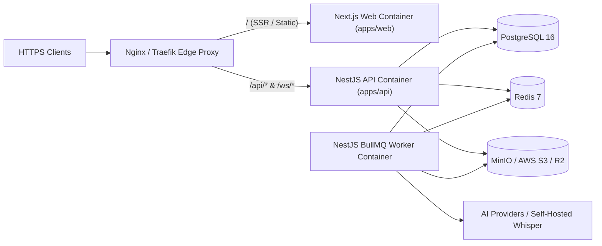

# Implementation Roadmap & Deployment Architecture

**Stack**: Next.js (App Router) · NestJS · PostgreSQL + Prisma · Redis (BullMQ + Socket.IO Adapter) · S3/MinIO · Docker  
**Rule**: No implementation code is started until this architecture set (`docs/`) is reviewed and approved.

---

## 1. Deployment Topology (Docker Compose -> Production Containers)

### Container Services (`docker-compose.yml` for Local/Staging; ECS/Fly/K8s in Production)
1. **`web`** (`apps/web`): Next.js standalone production server (`PORT=3000`), stateless across horizontal replicas.
2. **`api`** (`apps/api`): NestJS HTTP + Socket.IO WebSocket server (`PORT=4000`), stateless via Redis JWT/Session/WS adapter.
3. **`worker`** (`apps/api` `worker.main.ts`): Dedicated BullMQ consumer image containing `ffmpeg` binary for audio normalization and long-running `media-ingestion` / `ai-transcription` / `exam-maintenance` jobs (isolated from API latency).
4. **`postgres`**: PostgreSQL 16 with persistent volume, automated daily snapshots, and Prisma migrations (`prisma migrate deploy` in CI/CD release step).
5. **`redis`**: Redis 7 (`appendonly yes` for BullMQ reliability, separate key prefixes for cache vs. queues).
6. **`minio`** *(local/staging)* / **S3 or R2** *(production)*: Private bucket with CORS configured specifically for direct browser `PUT` pre-signed uploads from `web` origin and `Range` audio streaming.

---

## 2. Phased Delivery Roadmap (8 Weeks / 5 Milestones)

### Phase 0: Workspace & Core Foundations (Week 1)
- Initialize pnpm monorepo (`apps/web`, `apps/api`, `packages/contracts`, `packages/tsconfig`).
- Stand up `docker-compose.yml` (`postgres`, `redis`, `minio`), CI lint/typecheck/test pipeline, and Prisma schema baseline + initial migrations.
- Configure structured logging (`traceId`), Swagger OpenAPI generation, and healthcheck probes (`/health/live`, `/health/ready`).

### Phase 1: Identity, Billing Guardrails & Media Pipeline (Week 2)
- Implement `iam` module: Argon2id/Magic-Link + Google/Apple OAuth2 PKCE, short-lived JWT + `HttpOnly` rotated refresh cookies, `AccountStatusGuard`, `EntitlementGuard`, and `ComplianceGuard` (`ageVerifiedAt`).
- Implement `MediaAsset` S3 pre-signed upload/stream service + `ffmpeg` worker (`media-ingestion` queue).
- Build Next.js App Router shells (`(marketing)`, `(workspace)`, `(immersive)`), i18n setup (`next-intl`), and typed API client with single-flight `401` refresh.

### Phase 2: Audio Engine, Lessons & Stories (Weeks 3–4)
- Build browser-native `audio-engine`: `MediaTransportController`, `rAF` `SegmentClock`, `AudioWorklet` + negotiated `MediaRecorder` `CapturePipeline`, and Web Worker ONNX STT + client `PhonemeAligner`.
- Implement NestJS `lessons` module (`topics`, `dictation`, `shadowing`, `grammar`, `stories`, `comments`), `ai` provider abstraction (`ai_audit_logs`), and Pro YouTube import queue.
- Ship Dictation, Shadowing, Grammar, and Story Reader workspaces with E2E Playwright audio & sync tests.

### Phase 3: Vocabulary, SRS & IELTS/TOEIC Exam Engine (Weeks 5–6)
- Implement `vocabulary` (`decks`, `cards`, `dictionary` cache) + SM-2 `/srs/due` & `/srs/reviews`.
- Implement `exams` module: catalog, sets, parts/question-groups, timed `TEST` vs. `PRACTICE` sessions, `exam-maintenance` auto-submit cron, deterministic IELTS Band & TOEIC Scaled grading, `/result` review, and `/analytics` weak-area aggregation.
- Build full IELTS Listening/Reading and TOEIC 7-part exam runners in `apps/web`.

### Phase 4: Gamification, Realtime Community & Production Billing (Weeks 7–8)
- Implement `gamification` (`user_stats`, immutable `DiamondLedger` / `XpLedger`, `streaks`, `shop`, `missions`, monthly Redis ZSET leaderboard rollups).
- Implement `community` (`posts`, `friends`, WebSocket `/chat`, WebRTC signaling lobby for 1-on-1 `/speaking`, moderation queue) and `billing` (Stripe/Paddle + domestic QR webhooks with idempotency).
- Execute load testing, security audit (JWT reuse, S3 signed-URL expiry, RBAC bypass tests, AI budget exhaustion tests), and production cutover.

---

## 3. Pre-Coding Verification Checklist

Before writing application code, verify:
1. All Prisma model names and API routes match cleanly across [database-schema.md](file:///d:/parroto/docs/database/database-schema.md) and [api-specification.md](file:///d:/parroto/docs/api/api-specification.md).
2. `packages/contracts` Zod schemas are treated as the single source of truth for both NestJS DTO validation and Next.js form/fetch validation.
3. No test fixtures, S3 keys, or credentials are imported from `parroto.app`.
