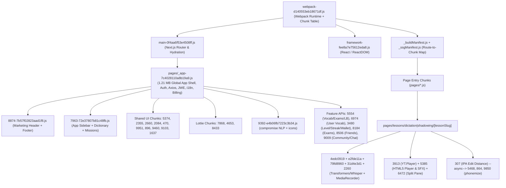

# Parroto Bundle Architecture & Chunk Relationships

**Target**: `https://parroto.app/`  
**Evidence References**:
- `webpack-d140553eb18671df.js` (`ev_4635258668499ca1fe6fb26d31c8a16faeb07b8df08f0f35624f96b297335960`)
- `_buildManifest.js` & `_ssgManifest.js` (`steps/313` / `steps/342`)
- `pages/practice-english-speaking-4f5de74a05cee57d.js` (`ev_4635258668499ca1fe6fb26d31c8a16faeb07b8df08f0f35624f96b297335960`)
- `307-dab1b7ab94ce73b7.js` (`steps/313`)
- `ev_c358b0d5443b536c6bac1785bbd89463e773ac82ba4069d0cc575b44e58491ba` (`analyze_javascript_application`)
- `ev_f125b2014834abf44f3c5e72b72b6290308b18fcac856ed6dbec2ec40dd5a7e9` (`observe_web_execution`)

---

## 1. Build System & Runtime Architecture (Verified Static Facts)

- **Framework & Bundler**: **Next.js (Pages Router)** backed by **Webpack** (`self.webpackChunk_N_E`), hosted on **Vercel** (deployment ID `dpl_AFkVi51shGHUhmQUyJiWgevLkwLR` observed in `webpack-d140553eb18671df.js` Vercel live-toolbar bootstrap).
- **Build ID**: `hUvNpCe7E_Hr-Ai_sSmoX` (observed in `/_next/static/hUvNpCe7E_Hr-Ai_sSmoX/_buildManifest.js`, `_ssgManifest.js`, and `/_next/data/hUvNpCe7E_Hr-Ai_sSmoX/*.json` runtime fetches).
- **Public Asset Path**: `__webpack_require__.p = "/_next/"`.
- **Trusted Types Support**: `webpack-d140553eb18671df.js` configures `trustedTypes.createPolicy("nextjs#bundler", ...)` when available.

---

## 2. Chunk Layer Hierarchy

---

## 3. Observed Webpack Chunk Maps & Dependencies

### A. Static Entrypoint Bootstrap Example (`practice-english-speaking-4f5de74a05cee57d.js`)
At the bottom of page chunks, Webpack registers `e.O(0, [...chunkIds], () => e(e.s=entryModuleId))`. For `/practice-english-speaking`, the required chunk dependency list is:
`[5374, 2355, 896, 2660, 9460, 9951, 3480, 8506, 9009, 7963, 9774, 2888, 179]` (`ev_4635258668499ca1fe6fb26d31c8a16faeb07b8df08f0f35624f96b297335960`).

### B. Dynamic On-Demand Chunks Registered in `webpack-d140553eb18671df.js`
`__webpack_require__.u(e)` maps **51 dynamic chunk IDs** (loaded via `__webpack_require__.e(id)` / `<script>` injection):
- **Named static splits**: `7868`, `5374`, `9460`, `8506`, `9009`, `4132`, `4653`, `8433`
- **Hash-prefixed / content-hashed dynamic chunks** (43 chunks): `296` (`ea88be26.21fe265b1bc4f005.js`), `378`, `517`, `522`, `864` (`ebadb445.12f5cdf99d497e62.js`), `1012`, `1167`, `1493`, `1594`, `1637`, `2251` (`674a26a7.0633924dd6e7c2bc.js`), `2305`, `3272`, `3288`, `3421`, `3591`, `3737` (`fb7d5399.ce6323df156f55ff.js`), `4793`, `4812`, `5123`, `5136`, `5220`, `5228`, `5265`, `5453`, `5468` (`8ef3129c.d2f47bd658afa599.js`), `5662`, `5735`, `5808`, `6197`, `6278`, `6919`, `6953`, `7199` (`a1ffd009.94913d5129935080.js`), `7712`, `7744`, `7836`, `8399`, `8953`, `9024`, `9193`, `9200`, `9260`, `9850`, `9993`.
- **Dynamic CSS Chunks (`__webpack_require__.miniCssF`)**:
  - `2888` → `static/css/a39a06b1590f397c.css` (global app stylesheet)
  - `7969` → `static/css/8aee48eb52f4c731.css`
  - `277, 2415, 2616, 2700, 4782, 5405, 8026, 8552` → `static/css/cecdbce2880c059c.css`

### C. Explicit Dynamic Import (`__webpack_require__.e`) Observed
- In `307-dab1b7ab94ce73b7.js` (module `80307`, `preloadPhonetics`):
  `Promise.all([a.e(5468), a.e(864), a.e(9850)]).then(a.bind(a, 69850))` asynchronously loads the `phonemize` IPA dictionary chunks (`ea`/`8ef3129c`, `ebadb445`, `7b466599eca73ad5.js`) only when phonetics/shadowing scoring is initialized.

### D. Runtime Prefetching Behavior (Runtime Evidence vs. Static)
- **Runtime Evidence** (`ev_d70629d2c51d537ea29e7cfb0000c21a2efecd89b62243928706855c0eac1d2c`, `ev_0b6d49270985540f55205125e0008a77ae50401118c6bfab0c0e98484c18898f`): Because Next.js `<Link>` prefetches visible routes in the viewport, loading `/` or `/topics` eagerly fetches both the JS chunks and `/_next/data/hUvNpCe7E_Hr-Ai_sSmoX/en/*.json` payloads for top-level routes (`/dashboard`, `/dictation`, `/shadowing`, `/vocabulary`, `/practice-english-speaking`, `/exams/ielts`, `/exams/toeic`, `/games`, `/grammar`, `/topics`).
- **Execution Separation** (`ev_f125b2014834abf44f3c5e72b72b6290308b18fcac856ed6dbec2ec40dd5a7e9`): Prefetched route chunks are parsed/registered into `self.webpackChunk_N_E` on load, **not** executed until the user navigates to those routes.

---

## 4. Confidence & Coverage Limitations

- **Confidence**: **High / Observed** for `webpack-d140553eb18671df.js`, `_buildManifest.js`, and runtime Next.js prefetching.
- **Limitations**:
  - `analyze_javascript_application` (`ev_c358b0d5443b536c6bac1785bbd89463e773ac82ba4069d0cc575b44e58491ba`) analyzed 9 core/page chunks statically without executing Webpack `push` handlers; cross-chunk module ID resolution inside the 37 unselected chunks was complemented by direct inspection of `webpack-d140553eb18671df.js` and `_buildManifest.js`.
  - Dynamic chunks not visited (e.g., `43-*.js` for `/affiliate`, `9536-*.js` for `/exams/*/session/[sessionId]`, `3425-*.js` for `/community-lessons/[id]/edit`) remain unexported.
