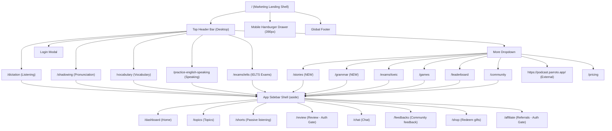

# Parroto Navigation Map

**Target**: `https://parroto.app/`  
**Evidence Sources**: `ev_7a1e7660783ab55108f78dea50b311774befc6c7e49719b526dc00e6cc1622b1`, `ev_d1b92d71c34e1116acdd3c5bd0a7c0512b51b57428dd391e6da018c508f36850`, `ev_24f34861406c3d30e1c8f0a03e934f81afa27dc2fa7550e97512089643f62828`, `ev_e7406c1fac39de6df8cef364bcd9ee1bb4046b80986235e54ab844a8c7de3ba6`, `ev_cb5ba38062d80485744efcb19434d1c473edecaa4010c06015e8a974c90dc22f`

---

## 1. Navigation Topology Overview

Parroto exposes **two primary navigation shells** depending on the route type, plus dedicated **mobile responsive drawers** at narrow viewports (`390x844`):

---

## 2. Marketing Shell Navigation (`/` & Editorial/Auth Pages)

### A. Desktop Header (`1280x720`)
- **Promo Top Bar** (above header, dismissible via `X`):
  - `"Teachers' Day Sale — Celebrate Teachers' Day with 25% off Parroto Lifetime — ... Claim offer now ->"` (opens Lifetime Checkout dialog)
  - App Store badge (`https://apps.apple.com/us/app/parroto-english-shadowing/id6752111996`)
  - Google Play badge (`https://play.google.com/store/apps/details?id=com.parroto.learnenglish`)
- **Primary Links**:
  - Logo `Parroto` -> `/`
  - `Listening` -> `/dictation`
  - `Pronunciation` -> `/shadowing`
  - `Vocabulary` -> `/vocabulary`
  - `Speaking` -> `/practice-english-speaking`
  - `IELTS Exams` -> `/exams/ielts`
  - `More v` (menu button with orange notification indicator) -> opens dropdown menu:
    1. `Stories` (`NEW`) -> `/stories`
    2. `Grammar` (`NEW`) -> `/grammar`
    3. `TOEIC Exams` -> `/exams/toeic`
    4. `Games` -> `/games`
    5. `Leaderboard` -> `/leaderboard`
    6. `Community` -> `/community`
    7. `Podcast` (external icon) -> `https://podcast.parroto.app/`
    8. `Pricing` -> `/pricing`
- **Utility Controls (Right)**:
  - Theme Toggle (Light/Dark)
  - UI Language Selector (`English v` — 17 languages)
  - Translation Language Settings (gear icon -> opens `"Select Your Translation Language"` modal)
  - `Login` button (opens `"Welcome Back"` modal)

### B. Mobile Header & Drawer (`390x844`) — `ev_24f34861406c3d30e1c8f0a03e934f81afa27dc2fa7550e97512089643f62828`
- **Collapsed Top Bar**: `Parroto` logo (left) + `Toggle menu` hamburger icon (right).
- **Opened Drawer**:
  - Top row: `Login` link (`/login`), UI Language selector (`flag English`), Theme toggle (`Light Mode`).
  - Flattened vertical link list (merges primary nav + `More` dropdown): `Listening`, `Pronunciation`, `Vocabulary`, `Speaking`, `IELTS Exams`, `Stories` (`NEW`), `Grammar` (`NEW`), `TOEIC Exams`, `Games`, `Leaderboard`, `Community`, `Podcast`, `Pricing`.

### C. Global Footer (`contentinfo`)
- **Brand & Apps**: `Parroto` (`/`), `Download on App Store`, `Get it on Google Play`
- **Information Column**: `Blog` (`/blog`), `Privacy Policy` (`/privacy-policy`), `About Us` (`/about-us`), `Authors` (`/authors`), `Terms of Service` (`/terms-of-service`), `Contact Us` (`/contact-us`), `Feedback` (`/feedbacks`)
- **Features Column**: `Shadowing` (`/shadowing`), `Dictation` (`/dictation`), `Vocabulary` (`/vocabulary`), `Grammar` (`/grammar`), `Stories` (`/stories`), `Speaking Practice` (`/practice-english-speaking`), `Vocab Battle` (`/vocab-battle`), `Games` (`/games`), `Podcast` (`https://podcast.parroto.app/`), `IELTS Exams` (`/exams/ielts`), `TOEIC Exams` (`/exams/toeic`)
- **Social Links**: Facebook, TikTok, LinkedIn, Threads, Product Hunt

---

## 3. Application Sidebar Shell Navigation (Inner App Pages)

### A. Desktop Left Sidebar (`<aside>`, `1280x720`) — `ev_e7406c1fac39de6df8cef364bcd9ee1bb4046b80986235e54ab844a8c7de3ba6`
- **Top Brand**: `Parroto` -> `/`
- **Main Learning Links**:
  1. `Home` -> `/dashboard`
  2. `Topics` -> `/topics`
  3. `Listening` -> `/dictation`
  4. `Pronunciation` -> `/shadowing`
  5. `Vocabulary` -> `/vocabulary`
  6. `Grammar` (`NEW`) -> `/grammar`
  7. `Speaking` -> `/practice-english-speaking`
  8. `TOEIC Exams` -> `/exams/toeic`
  9. `IELTS Exams` -> `/exams/ielts`
  10. `Games` -> `/games`
  11. `Stories` (`NEW`) -> `/stories`
  12. `Passive listening` -> `/shorts`
  13. `Podcast` -> `https://podcast.parroto.app/`
  14. `Review` -> `/review`
- **Community Section**:
  15. `Community` -> `/community`
  16. `Leaderboard` -> `/leaderboard`
  17. `Chat` -> `/chat`
  18. `Community feedback` -> `/feedbacks`
  19. `Redeem gifts` -> `/shop`
  20. `Referrals` -> `/affiliate`
  21. `Pricing` -> `/pricing`
- **Sidebar Footer Controls**: `Scroll for more` button, `LOGIN` button, `Translation Language` gear icon, `<< Collapse` toggle.

### B. App Shell Top Bar (`banner`)
- **Desktop**: `Search dictionary` button (opens `Dictionary` modal), `Translation Language` gear button, Theme toggle, `English v` language selector.
- **Mobile (`390x844`)** — `ev_cb5ba38062d80485744efcb19434d1c473edecaa4010c06015e8a974c90dc22f`: Left `<aside>` collapses completely; top bar displays `[Open menu]` (hamburger) + `[Parroto]` + `[Search dictionary]` icon button.

---

## 4. Key Content Drill-Down Paths

- `/topics` or `/dictation` or `/shadowing` → `/topics/[slug]` (e.g., `/topics/ielts-listening`, `/topics/toeic-listening`) → `/lessons/dictation/[slug]`
- `/exams/ielts` → `/exams/ielts/sets/[setSlug]` → `/exams/ielts/[examSlug]` → *(Login Gate on `Start Exam`)*
- `/exams/toeic` → `/exams/toeic/sets/[setSlug]`
- `/vocabulary` → `/vocabulary/[id-or-slug]` *(24-word preview public; study auth-gated)*
- `/grammar` → `/grammar/[slug]`
- `/stories` → `/stories/[slug]`
- `/games` → `/vocab-battle` *(Auth-gated)* or `/vocabulary/[game-slug]` (e.g., `/vocabulary/word-rain`)
- `/blog` → `/blog/categories/[slug]` → `/blog/[slug]`
